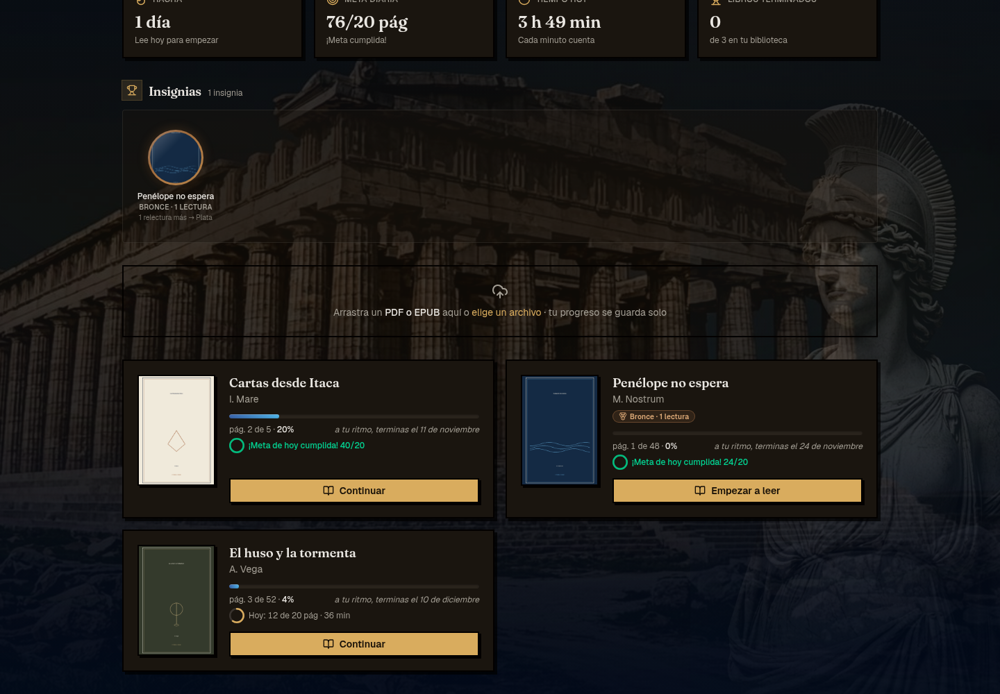
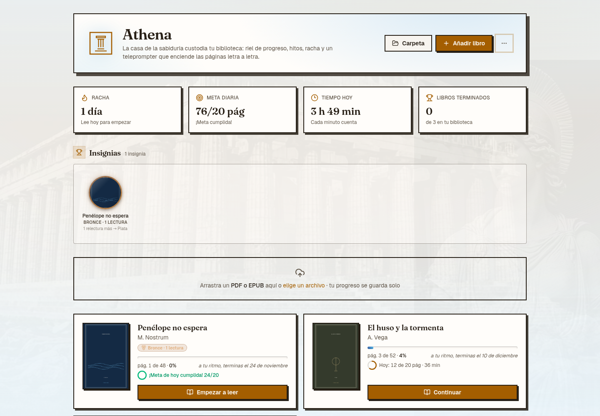
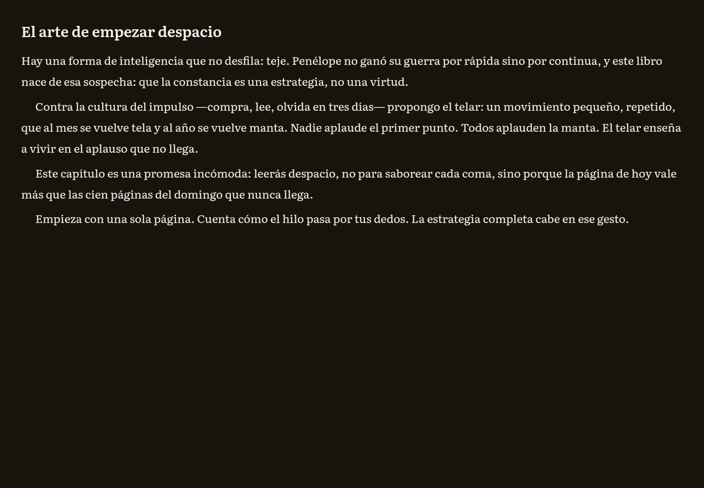
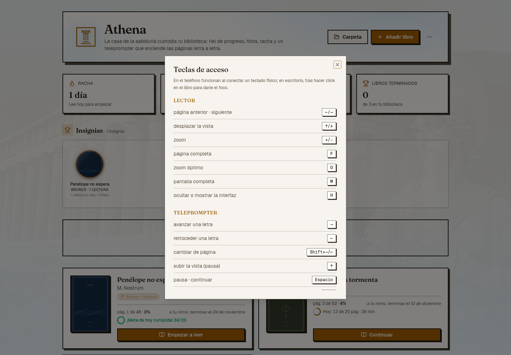
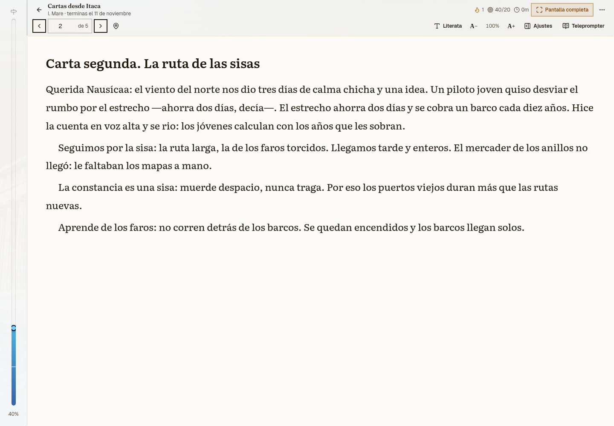

<div align="center">


### Finish your books.

A local-first reading app with a progress rail, streaks, honest ETAs
and a letter-by-letter teleprompter. Your library never leaves your machine.

React 19 · Vite · Express · SQLite (zero-config) · PDF.js · Tesseract OCR

[](https://github.com/MoriNo23/Athena/actions/workflows/ci.yml)
[](https://github.com/MoriNo23/Athena/releases)
[](LICENSE)

[](https://github.com/MoriNo23/Athena/releases)
[](https://github.com/MoriNo23/Athena/releases)

</div>

---

## The library that wants you back

Every book sits on a **rail**: a segmented progress track with named
milestones, a reading streak, and an honest *“last page on March 4”* ETA.
Cross a milestone and Athena throws confetti — then asks you to come back
tomorrow. That's the whole product: one more page, today.

| Your library at night — *egean* blue | The same shelf by day — *marble* morning |
|:---:|:---:|
|  |  |

## Two ways to read

**The reader** treats PDFs and EPUBs the same: clean pagination
(~320 words per virtual page), three reading fonts, zoom presets, and an
immersion mode where the interface fades away until you touch it again.

**The teleprompter** turns any page into one continuous stream that flows
letter by letter at your pace. Rewind with `←`, adjust the type from
`0.8×` to `1.6×`, and let the camera do the scrolling — it yields the
instant you scroll yourself. Reading becomes a film.

| The reader — serif, quiet, in control | The teleprompter — one stream, letter by letter |
|:---:|:---:|
|  |  |

| Every shortcut, one panel away | The reader toolbar in marble morning |
|:---:|:---:|
|  |  |

## What you get

- **Rail + streak + honest ETA** under every book — progress you can *see*,
  not a bare percentage. Confetti at every milestone.
- **EPUB & PDF**, paginated identically. **OCR for scanned PDFs** runs
  in your browser with Tesseract — nothing is uploaded anywhere.
- **Teleprompter mode** — letter-by-letter pacing with manual rewind.
- **Literature tools** — X-ray, outline, dictionary, natural pauses,
  argument skeleton, locked notes, dual-read.
- **ES / EN / PT** — the whole interface switches, including dates.
- **Shortcuts & gestures** — a shortcuts panel in the library and reader
  menus, on Android and desktop alike.
- **Offline APK** — the same app in your pocket, with a hand-triggered
  **home copy** to pull/push your library from your own server over the LAN.
- **Zero config** — the database is SQLite built into the runtime: it is
  created on first run. No `.env`, no migrations, no accounts, no telemetry.

## Install

**Desktop — from source (2 commands):**

```bash
git clone https://github.com/MoriNo23/Athena.git && cd Athena
bun install && bun run dev     # → http://localhost:3000
```

Drop a PDF or EPUB on the library and start reading. Books live outside
the code, in `~/.local/share/athena` (override with `ATHENA_HOME`); each
book can weigh up to 200 MB. Internet is only needed for the install and
the first OCR language download.

**Debian / Ubuntu:**

```bash
sudo apt install ./athena_<version>_amd64.deb
athena start                   # → http://localhost:3000   (athena start --lan for LAN)
```

**Other Linux:** grab `Athena-<version>-x86_64.AppImage` from
[releases](https://github.com/MoriNo23/Athena/releases) — one file with
Node inside, `chmod +x` and run (your library lives in
`~/.local/share/athena`, never inside the image). Prefer a tarball?
`Athena-<version>-linux-x64.tar.gz` unpacks and follows
`COMO-ARRANCAR.txt`.

**Android:** grab `Athena-v<version>.apk` from
[releases](https://github.com/MoriNo23/Athena/releases) — every tag `v*`
builds it automatically (or run the *Athena Android* workflow by hand).
Reading works fully offline; the optional password lock is only for LAN
mode (`ATHENA_PASSWORD` in the shell — never a config file).

## Under the hood

One Vite SPA served by one Express process that also hosts the API —
a single port, a single `bun run build`. The schema lives inside
`src/lib/db.ts` and the database boots itself: no ORM, no generated
client, no migration step, and old Prisma-era libraries keep working as-is.
The APK is the same app with an offline engine (`public/athena-offline.js`)
that mirrors the whole API over IndexedDB/OPFS.

```bash
bun run dev          # develop: web on 3000 + API on 3001
bun run build        # production: dist/ + server-dist/server.cjs
bun run start        # serve web + API from one port (Node ≥ 23.4)
bun run athena       # house CLI: init · start · doctor · backup · bundle · home
```

```
index.html · login.html   entries      server/   Express + /api/**
src/core/                 house rules  src/lib/  sqlite · pdf.js · ocr · i18n
src/components · hooks/   UI           public/   offline engine · brand
scripts/                  build+CLI    android/  Capacitor/Gradle
```

[MIT](LICENSE) — clone it, modify it, self-host it. Your library stays yours.
