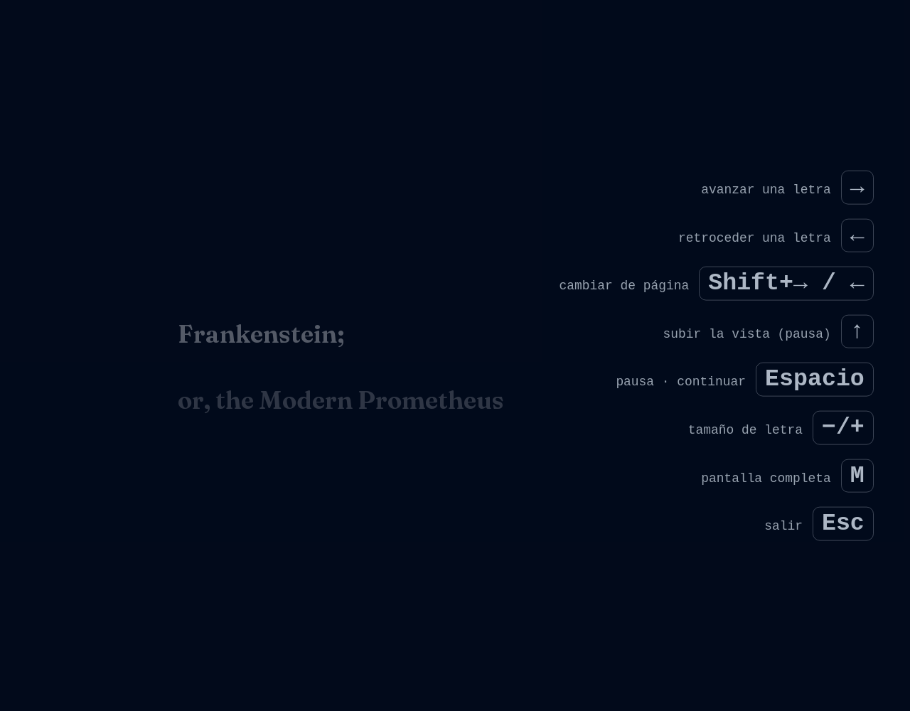
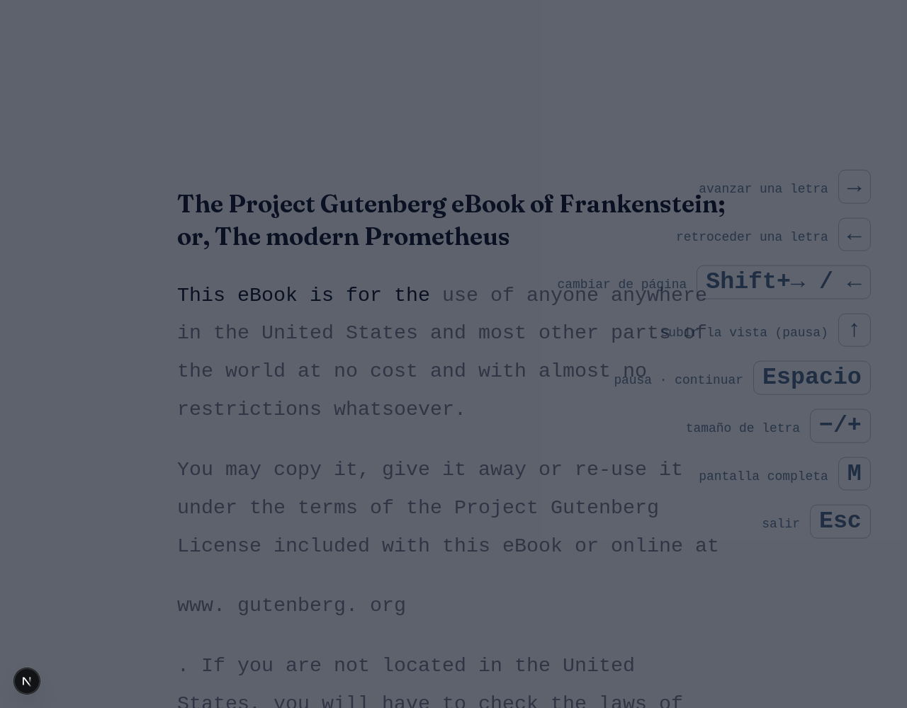

<div align="center">


### FINISH YOUR BOOKS.

A local-first reading app: PDF/EPUB library, progress rail, streaks,
honest ETA to the last page, and a letter-by-letter teleprompter mode.

React 19 · Vite · Express · TypeScript · Tailwind 4 · SQLite (zero-config) · PDF.js

[](https://github.com/MoriNo23/Athena/actions/workflows/ci.yml)
[](https://github.com/MoriNo23/Athena/releases)
[](LICENSE)
[](https://github.com/MoriNo23/Athena/actions/workflows/apk.yml)
[](https://github.com/MoriNo23/Athena/releases)

**[Download APK](https://github.com/MoriNo23/Athena/actions/workflows/apk.yml)** ·
**[Download releases](https://github.com/MoriNo23/Athena/releases)** ·
**[Report a bug](https://github.com/MoriNo23/Athena/issues)**

</div>

---

## WHAT IT IS

Athena is a reading app you run yourself. No accounts, no cloud, no
telemetry: your library lives on your machine (data home at
`~/.local/share/athena`) and the same app ships as an offline Android APK.

Under every book there's a **rail**: a segmented progress track with
milestones, a streak, the honest ETA to the final page, and confetti when
you cross a milestone. That's the product — getting you back to the book
today.

## WHAT IT LOOKS LIKE

| The library at night — *egean* blue | The library by day — *marble* morning |
|:---:|:---:|
|  |  |

| Teleprompter — one stream, letter by letter | The same stream by day — the type is yours (A− / A+) |
|:---:|:---:|
|  |  |

### What you get

- **Rail + streak + ETA** under every book — progress you can see, not a percentage.
- **Teleprompter** — one continuous stream, letter by letter, font `0.8×–1.6×`, rewind with `←`.
- **Immersion** — UI hides on idle (`H`), fullscreen, controls fade out.
- **EPUBs & PDFs** paginated the same way (~320 words/virtual page).
- **OCR for scanned PDFs** — Tesseract runs on demand, in your browser; nothing is uploaded anywhere.
- **Literature settings** — X-ray, outline, dictionary, natural pauses, argument skeleton, locked notes, dual read.
- **ES / EN / PT** — the whole interface switches.
- **Keyboard shortcuts & gestures** — a shortcuts panel in the library and reader menus (Android and desktop); the desktop ghost hint only appears on real desktop input, never on touch.
- **Home copy** — pull/push your library and progress between the Android app and your own server over your home network, always by hand.
- **Zero config** — the database is plain SQLite from the runtime itself: it is created on first run, no `.env`, no migrations, no client generation.
- **Offline-first** — reading works without internet.

## INSTALL

**Prerequisites:** [Bun](https://bun.sh) for development, Node ≥ 23.4 for
production. Internet is only needed for the install and the first OCR
language download — **reading works offline.**

### From source (2 commands)

```bash
git clone https://github.com/MoriNo23/Athena.git
cd Athena
bun install
bun run dev        # → http://localhost:3000
```

That's all. On first run Athena creates its database in the data home
(`~/.local/share/athena`) — no `.env` to copy, no schema to push. Drop a
PDF or EPUB on the library and start reading.

> **Sizes:** each book can weigh up to **200 MB** (PDF or EPUB); the upload
> path accepts up to 256 MB so heavy books reach the API whole.

### Debian / Ubuntu — installer

Download `athena_<version>_amd64.deb` from
[releases](https://github.com/MoriNo23/Athena/releases) and:

```bash
sudo apt install ./athena_<version>_amd64.deb   # app in /opt/athena + `athena` on your PATH
athena start      # → http://localhost:3000   (LAN mode: athena start --lan)
```

Nothing is installed at package time: the build is self-contained and the
database creates itself on the first run. Removing the package never
touches your library.

### Linux tarball

`Athena-<version>-linux-x64.tar.gz` from
[releases](https://github.com/MoriNo23/Athena/releases): unpack and follow
`COMO-ARRANCAR.txt` — no dependencies, straight to reading.

### Android — offline APK

Grab the latest **Athena-apk** artifact from the
[APK workflow](https://github.com/MoriNo23/Athena/actions/workflows/apk.yml)
(it rebuilds on every push to `main`), or `Athena-v<version>.apk` from
[releases](https://github.com/MoriNo23/Athena/releases). The same app in a
WebView with an offline engine that mirrors the whole experience on-device —
including the **home copy** to your own computer over the home network.

## THE STACK

One Vite SPA (`index.html` + `login.html`) served by one Express server
(`server/index.ts`) that also hosts `/api/**` and the optional password
lock. `bun run build` produces `dist/` + `server-dist/server.cjs` and Node
serves it all from one port. The database is the SQLite built into the
runtime (`node:sqlite` in Node, `bun:sqlite` in Bun) — `src/lib/db.ts`
embeds the schema and mirrors the small query surface the API needs, so
there is no ORM, no generated client and no migration step. The APK is the
same SPA compiled without the login page; the offline engine
(`public/athena-offline.js`) answers `/api/*` inside the WebView over
IndexedDB/OPFS.

**Everyday scripts:**

| Command | What it does |
|---|---|
| `bun run dev` | Dev: Vite web on 3000 + Bun API on 3001 |
| `bun run build` + `bun run start` | Production mode (Node serves web + API) |
| `bun run lint` | ESLint pass |
| `bun run athena` | House CLI: `init · start · doctor · backup · bundle · home` |

Your books, covers and progress live **outside the code**, in the data home
(`~/.local/share/athena`, overridable with `ATHENA_HOME`). They are
gitignored on purpose: **your library never leaves your machine.** The only
optional environment variable for daily use is `ATHENA_PASSWORD` (the lock
for LAN mode), set it in the shell when you start Athena.

## REPO LAYOUT

```
├── index.html · login.html     # the two pages (login = the lock's gate)
├── server/                     # Express: statics, lock, /api/** routes
├── src/                        # core rules, UI components, data layer
│   ├── core/                   # house kernel: no framework imports
│   ├── lib/                    # glue: sqlite, PDF.js, OCR, i18n
│   └── components/ · hooks/    # shadcn/ui + Tailwind
├── public/                     # offline engine, brand, pdf.js worker
├── scripts/                    # build/dev/apk packaging + house CLI
├── tests/                      # integration: offline engine, bundle
└── android/                    # Capacitor/Gradle project for the APK
```

The root holds only project configuration. The ~200 pdf.js asset files
(cmaps, standard fonts, wasm) are not tracked: `scripts/sync-pdfjs.mjs`
copies them from `node_modules` at install and build time.

## RELEASE CHECKLIST

Everything a clone must pass before a release or a pull request — run them
from the repo root, in this order:

```bash
bunx tsc --noEmit        # 0 type errors
bun run lint             # 0 errors, 0 warnings
bun test                 # full suite green (the CI workflow enforces all three)
bun run build            # production build compiles (dist/ + server-dist/)
```

## LICENSE

[MIT](LICENSE) — clone it, modify it, self-host it. Your library stays yours.
