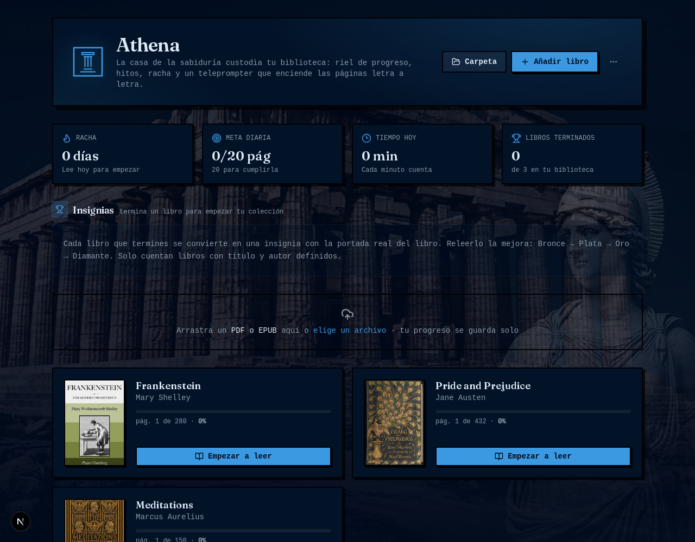
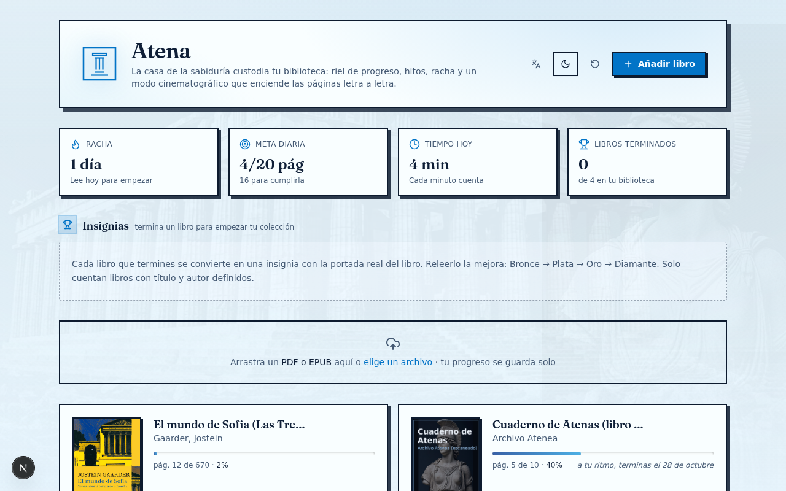
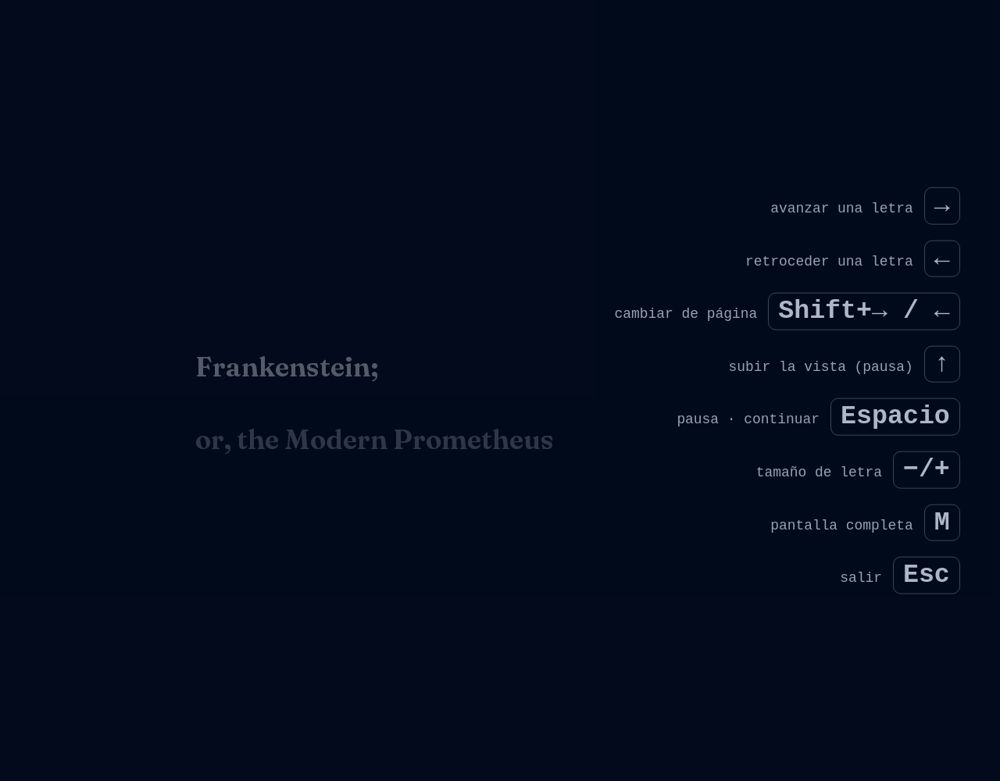
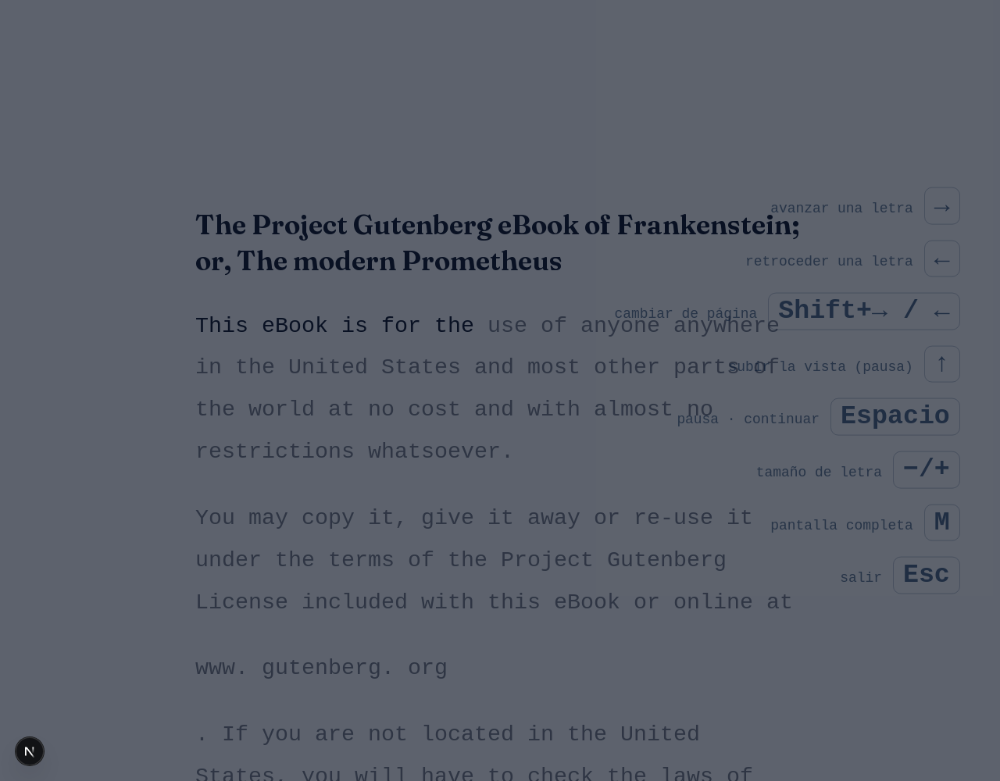

<div align="center">


### FINISH YOUR BOOKS.

A local-first reading app that treats **the last page** as the product.

React 19 · Next.js 16 · TypeScript · Tailwind 4 · Prisma + SQLite · PDF.js

</div>

---

## THE PROBLEM

People don't abandon books at a bad chapter. They abandon them when the habit dies.

One missed day becomes three. Three becomes "I'll restart next month." Meanwhile every
e-reader on earth shows you the same sterile thing: a percentage. A number that shames
you instead of moving you.

**Atena is built on a different contract:**

> Your library lives on your machine, and the app's only job
> is to get you back on the rail today.

The rail — *el riel* — is a segmented progress track that lives under every book.
It has milestones, it has a streak, it tells you the honest ETA to the final page,
and it throws confetti when you cross a milestone. Not gamification noise. One clear
instrument, tuned for consistency.

## WHAT IT LOOKS LIKE

| The library at night — *egean* blue | The library by day — *marble* morning |
|:---:|:---:|
|  |  |

| Teleprompter — one stream, letter by letter | The same stream by day — the type is yours (A− / A+) |
|:---:|:---:|
|  |  |

### House rules

The interface is a statement, not a decoration:

- **Blue is focus.** Color psychology picked the hue: a deep *egean night* when dark,
  a calm *marble morning* when light. Nothing screams; everything holds your attention.
- **Neo-brutalism.** Zero corner radius. Hard 2px ink borders. Shadows that are offset,
  not blurred. Buttons that physically press. What you see is what the UI is.
- **The teleprompter obeys the text.** Pages are stitched into one continuous
  stream: headings appear whole, letters light one at a time, and the active
  letter is held at a comfortable line while the page advances under it — no
  border, no chrome between you and the sentence. Font size scales from 0.8× to
  1.6× with `A−` / `A+` (or the `−` / `=` keys); `←` rewinds letter by letter.
- **Immersion goes all the way.** Hide the UI (idle or the `H` key) or go fullscreen and
  the page opens up: no side gutters, a wider measure, just the book. The teleprompter
  hides its own controls after a few quiet seconds and wakes on any movement — Tab
  included, so keyboard readers are never stranded.
- **EPUBs become paperback pages.** Reflowable text is paginated into virtual
  pages of ~320 words, so the rail, streaks, ETA and the teleprompter work
  exactly the same as with PDFs.
- **PDFs reflow too.** A text mode paginates the extracted PDF text into virtual
  pages with real reading faces — Literata, EB Garamond, Atkinson Hyperlegible —
  while the rail and the header keep counting the PDF's real pages.
- **Three languages, one house.** Español, English and Português from the language
  switcher — the whole interface follows, dates included.
- **A literature dock, not a toolbox.** Reading settings are seven literature-minded
  toggles — X-ray, outline, dictionary, natural pauses, argument skeleton, locked notes,
  dual read — no preset theater.

## RUN IT

**Prerequisites:** [Bun](https://bun.sh) (it replaces Node + npm), any modern browser.
Internet is only needed for the install and the first OCR language download —
**reading works offline.**

```bash
git clone https://github.com/MoriNo23/atena.git
cd atena

cp .env.example .env     # one line: DATABASE_URL=file:../db/custom.db
bun install              # also runs prisma generate (postinstall)
bunx prisma db push      # creates the empty SQLite library on first run
bun run dev              # → http://localhost:3000
```

Drop a PDF or EPUB on the library. That's the whole onboarding.

> Why `file:../db/custom.db`? Prisma resolves the SQLite path relative to
> `prisma/`, so this single line lands the library at `<repo>/db/custom.db`
> on any machine — no edits, no absolute paths, no `prisma/db/` strays.

**Everyday scripts:**

| Command | What it does |
|---|---|
| `bun run dev` | Dev server on port 3000 |
| `bun run build` + `bun run start` | Optional production mode |
| `bun run lint` | ESLint pass |
| `bun run db:push` | Apply Prisma schema changes |

Your books, covers and progress live in `db/custom.db` + `public/uploads/` — copy those
two to back everything up. They are gitignored on purpose: **your library never leaves
your machine.** The Spanish quick-start guide with troubleshooting lives in
[`LEEME.md`](LEEME.md).

## RELEASE CHECKLIST

Everything a clone must pass before a release or a pull request — run them from
the repo root, in this order:

```bash
bunx tsc --noEmit        # 0 type errors
bun run lint             # 0 errors, 0 warnings
bun run build            # production build compiles
```


## LICENSE

[MIT](LICENSE) — clone it, modify it, self-host it. Your library stays yours.

## ROADMAP

- [x] **EPUB support** — virtual pages, chapter outline, metadata covers.
- [x] **Interface in three languages** — español, English, Português.
- [x] **Teleprompter mode** — one continuous stream, letter-by-letter lighting,
  headings revealed whole, idle-hiding controls, fullscreen, cut-to-typing sound
  on skip.
- [x] **Reflowed PDF text mode** — virtual pages, reading fonts, teleprompter fed
  by the reflow.
- [ ] **Per-book font scale** — the reading type size is currently global.
- [ ] **Bolder light-theme shadows** — the dark house wears its ink more proudly.
- [ ] **Touch refinements** — desktop-first by design; phones deserve intent, not leftovers.

---

<div align="center">

**ATENA** — *the rail takes you to the last page.*

</div>
